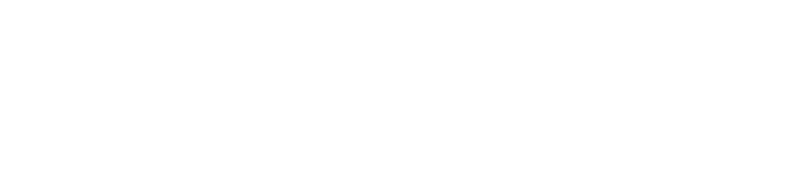

<div align="center">

<!-- MINIMALIST WHITE MOONSPACE HERO -->
<br/>

<br/><br/>

<!-- DYNAMIC TYPING SVG (NO EMOJIS) -->
<a href="https://github.com/tijeyoff">
  
</a>

<br/><br/>

<!-- OFFICIAL LOGO / ICON BADGES -->
<p align="center">
  <a href="https://www.behance.net/tijeystudio" target="_blank">
    
  </a>
  &nbsp;
  <a href="https://extensions.blender.org/author/33967/" target="_blank">
    
  </a>
  &nbsp;
  <a href="https://discordapp.com/users/@tijeyy_off" target="_blank">
    
  </a>
  &nbsp;
  <a href="https://t.me/tijey_12057" target="_blank">
    
  </a>
  &nbsp;
  <a href="https://instagram.com/tijey_official_" target="_blank">
    
  </a>
</p>

</div>

---

### Creative Identity & Focus

```yaml
creator:
  handle: "tijeyoff"
  display_name: "TIJEY"
  studio: "TIJEY Studio"
  origin: "Uzbekistan, Syrdarya, Yangiyer"
  craft: "3D Character Art, Physics Animation & Technical Art"
  primary_focus:
    - "3D Character Animation Pipelines (Cascadeur <-> Blender)"
    - "Production-Ready Blender Add-ons & Tooling"
    - "Python Workflow Automation & Media Bots"
  mission: "Building intuitive, mathematically precise motion tools for 3D creators."
  status: "Developing next-generation character animation workflows"
```

---

### Creative & Technical Toolkit

<div align="center">

#### **3D Art, Animation & Pipelines**
<p align="center">
  
  &nbsp;
  
  &nbsp;
  
</p>

#### **Scripting, Toolmaking & Platforms**
<p align="center">
  
  &nbsp;
  
  &nbsp;
  
  &nbsp;
  
</p>

</div>

---

### Flagship Projects & Pipelines

<table>
  <tr>
    <td width="50%">
      <h3 align="center">In-Place Animation Tool</h3>
      <p align="center">
        
        
        
      </p>
      <p>Blender add-on converting Root Motion animations into clean in-place animations. Features true <b>3D World Matrix projection</b> eliminating bone tilt coupling & ground sinking, ground height preservation, and game engine root bone extraction (Unreal Engine / Unity / Roblox).</p>
      <p align="center">
        <a href="https://github.com/tijeyoff/inplace-anim-tool"><b>View Repository ➔</b></a> &nbsp;|&nbsp;
        <a href="https://extensions.blender.org/add-ons/inplace_anim_tool/"><b>Blender Extensions ➔</b></a>
      </p>
    </td>
    <td width="50%">
      <h3 align="center">Cascadeur ↔ Blender Bridge</h3>
      <p align="center">
        
        
        
      </p>
      <p>Direct real-time pipeline tool bridging <b>Cascadeur physics-based character animation</b> directly into <b>Blender</b>. Enables frictionless scene roundtripping, armature synchronization, and error-free animation export.</p>
      <p align="center">
        <i>Studio Pipeline Tool (In Active Development)</i>
      </p>
    </td>
  </tr>
  <tr>
    <td colspan="2" width="100%">
      <h3 align="center">Insta-Saver Bot</h3>
      <p align="center">
        
        
        
      </p>
      <p align="center">Automated high-speed Telegram bot for downloading media and reels with secure session handling and memory stream optimization.</p>
      <p align="center">
        <a href="https://github.com/tijeyoff/Insta-Saver-Bot"><b>View Repository ➔</b></a>
      </p>
    </td>
  </tr>
</table>

---

### GitHub Telemetry

<div align="center">

<p align="center">
  
  
</p>

</div>

---

### Connect & Collaborate

<div align="center">

<p align="center">
  Have a 3D animation challenge, pipeline idea, or creator tool collaboration? Feel free to reach out.
</p>

<p align="center">
  <a href="https://www.behance.net/tijeystudio" target="_blank">
    
  </a>
  &nbsp;
  <a href="https://t.me/tijey_12057" target="_blank">
    
  </a>
  &nbsp;
  <a href="https://discordapp.com/users/@tijeyy_off" target="_blank">
    
  </a>
  &nbsp;
  <a href="https://instagram.com/tijey_official_" target="_blank">
    
  </a>
</p>

</div>
